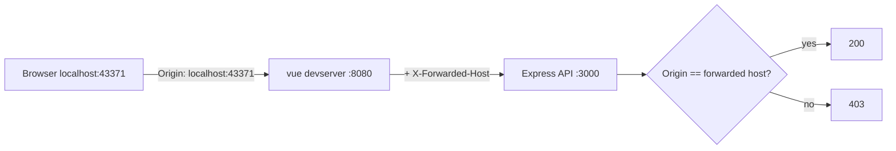

# Running behind a forwarded port

The dev stack binds fixed ports (API 3000, web 8080), but it is often *reached* on a
different one. Running several agents on one machine, each in its own container or
network namespace, means the browser talks to a forwarded port like
`http://localhost:43371/` while the stack inside still believes it is `:8080`.

This works with no configuration. Nothing to export, no port to pin.

## How it works

The app does not hold a fixed idea of its own public URL in development. It derives the
origin from each request, so whatever host and port the browser used is what the app
considers "itself".



Three pieces make this work:

- **`utils/requestOrigin.js`** — `resolveRequestOrigin(req)` builds `scheme://host:port`
  from `X-Forwarded-Proto`/`X-Forwarded-Host`, falling back to `Host`. It reads raw
  headers on purpose: Express's `req.hostname` strips the port, and the port is the only
  thing distinguishing one agent's stack from another's.
- **`webinterface/vue.config.js`** — the `/api` proxy sets `xfwd: true` so the API learns
  the browser's host. `changeOrigin: true` alone rewrites `Host` to the target and the
  outer port is lost.
- **`middleware/auth.js`** and **`routes/events.js`** — the same-origin check and the
  OAuth redirects follow the request origin instead of a hardcoded `appUrl`.

## Security

The same-origin check is not weakened. Comparing `Origin` against the request's own host
is the standard CSRF defence; a cross-site caller still sends its own `Origin` and is
still rejected with 403, and the `Sec-Fetch-Site: cross-site` rejection is unchanged.

This request-derived behaviour is **development only**. With `NODE_ENV=production` the
app pins everything to the configured `appUrl`, because there the public URL is known and
a client could otherwise spoof `X-Forwarded-Host`.

## Hot reload

`client.webSocketURL` is set to `auto://0.0.0.0:0/ws`. Those are placeholders: the
webpack-dev-server client substitutes `window.location`'s hostname, port, and protocol.
Without it the dev server bakes its *internal* address into the bundle
(`hostname=10.0.2.100&port=8080`), which your browser cannot reach — so hot reload dies
silently, with no error and no updates.

`auto:` also means an https tunnel gets `wss:` automatically.

## Hostnames, not just ports

`allowedHosts: 'all'` is set, so fronting the stack with a real hostname or a tunnel
domain works. Without it the dev server answers `Invalid Host header` for anything that
is not localhost or an IP.

## Requirements of the forwarder

The forwarder must pass `Host` through unchanged, or set `X-Forwarded-Host` itself.
`socat`, `kubectl port-forward`, SSH `-L`, and Docker `-p` all do.

## Overriding it

To pin the origin explicitly — a tunnel whose forwarder rewrites `Host`, say — set
`AUTOTASKCALENDAR_BASE_URL`:

```bash
AUTOTASKCALENDAR_BASE_URL=https://agent3.example.dev npm run dev
```

That is the fallback when no forwarding headers are present; it is not normally needed.

## Testing

`tests/api/proxied-origin.spec.js` covers it: a matching `Origin` plus `X-Forwarded-Host`
on an unusual port is accepted, a mismatched `Origin` is still 403, and redirects point
back at the forwarded host.
