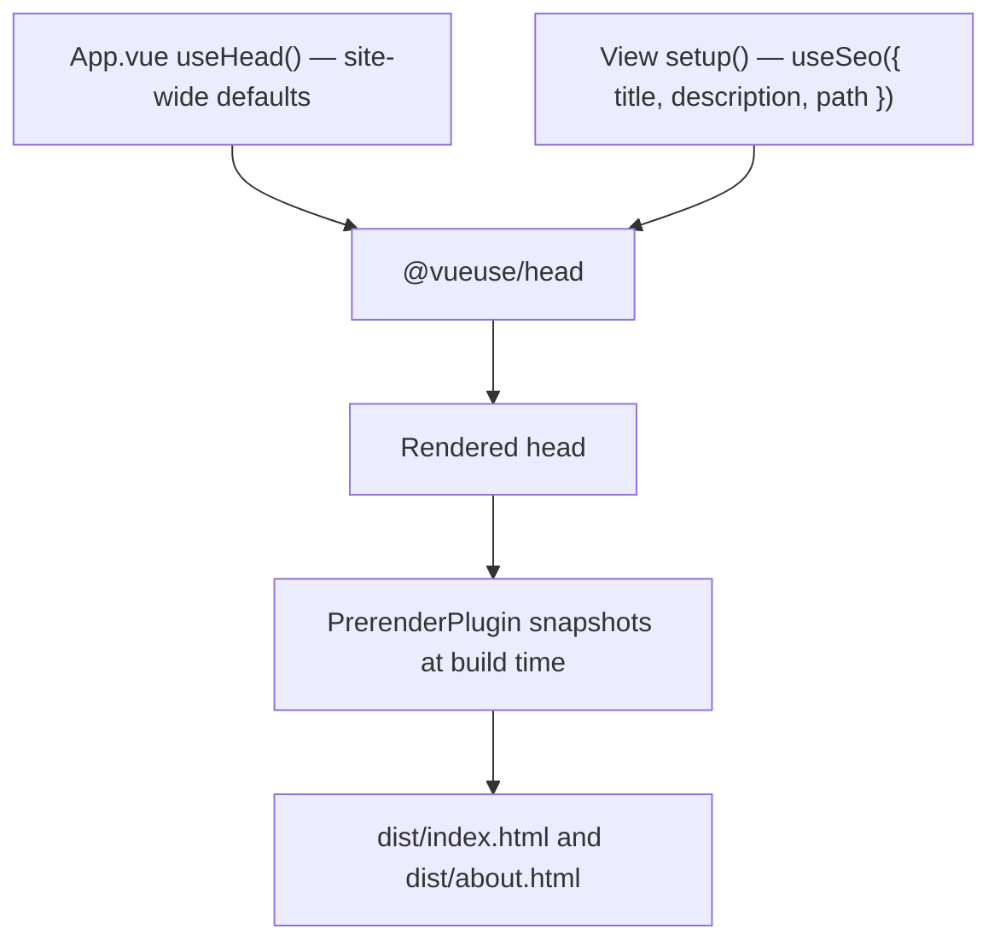

# SEO and the public pages

How AutoTaskCalendar presents itself to search engines and link previews: where page
metadata comes from, how the public pages are prerendered, and what to do when you add a
page. This file is the whole manual.

The public surface is small and deliberate: **`/` and `/about`**. Everything else is
private and asks not to be indexed.

---

## The one rule

> **Never add a `metaInfo` option to a component.** Use `useSeo()` in `setup()`.

`metaInfo` is the [vue-meta](https://vue-meta.nuxtjs.org/) 2.x API. This app has never had
vue-meta installed. It uses [`@vueuse/head`](https://github.com/vueuse/head), which does
not read `metaInfo` and never will.

This is not hypothetical. Seven views carried a `metaInfo` block — titles, descriptions,
Open Graph tags, the lot — and **every one of them was dead code**. Because nothing
asserted on the rendered `<head>`, nothing failed. Meanwhile the only `useHead()` call in
the app still held template boilerplate, so the live meta description on every page read:

> *"Easily manage your Github issues using this tool."*

That is what Google displayed under the result. `tests/ui/seo.spec.js` now fails if any of
that comes back.

---

## How a page gets its metadata



Three pieces:

| File | Responsibility |
| --- | --- |
| `src/seo/siteConfig.js` | Site name, tagline, production URL, default description, `og:image`. One source of truth. |
| `src/composables/useSeo.js` | Turns a page's title/description/path into a complete tag set. |
| `src/App.vue` | Site-wide defaults every page inherits. |

`@vueuse/head` dedupes by `name`/`property`, so a page's values win over the defaults.

### Adding a page

In the view's `setup()`:

```js
import { useSeo } from '@/composables/useSeo';

export default {
  name: 'Pricing',
  setup() {
    useSeo({
      title: 'Pricing',                       // becomes "Pricing | AutoTaskCalendar"
      description: 'What it costs and why.',  // 50-160 characters
      path: '/pricing',                       // drives canonical and og:url
    });
  },
};
```

A **private** page passes `noindex` instead, and needs no description or path:

```js
useSeo({ title: 'My calendar', noindex: true });
```

`noindex: true` emits `robots: noindex, nofollow`, omits `og:image`, and deliberately emits
**no canonical** — claiming a canonical URL for a page you are asking engines to ignore is
a contradictory signal.

If a public page is added, it must also be added to **three** other places:

1. `PRERENDER_ROUTES` in `webinterface/vue.config.js`
2. `webinterface/public/sitemap.xml`
3. `tests/ui/seo.spec.js`, if it deserves its own assertion

And if a **private** page is added, add it to the `Disallow` list in
`webinterface/public/robots.txt`.

---

## Clean URLs

The router uses `createWebHistory`, so pages live at `/about`, not `/#/about`.

This matters more than it looks. A crawler discards everything after the `#`, so under the
old hash routing **the entire site looked like a single page** — `/about` was unreachable
to search engines even though `sitemap.xml` advertised it and `robots.txt` allowed it.
Those URLs returned 404, because Express only served `dist/` and `/api`.

Two things make real paths work:

- **`app.js`** has a catch-all, mounted last, that serves HTML for non-asset GETs. It skips
  `/api/*` (a missing endpoint should 404 as itself) and skips any path with a file
  extension (a missing asset should 404 rather than silently receive HTML, which breaks
  module loading with a confusing MIME type).
- **`vue.config.js`** sets `devServer.historyApiFallback` so the dev server behaves the same.

Links shared before the switch still arrive as `/#/about`. `src/router/index.js` translates
that form once on load, so old bookmarks and inbound links are not lost.

---

## Prerendering

The app is client-rendered: without JavaScript the HTML is an empty `<div id="app">`.
Google executes JavaScript, but Bing and essentially every link-preview bot — Slack,
LinkedIn, Twitter/X, iMessage, WhatsApp — do not. Unprerendered, a shared link shows a
blank card.

`webinterface/build/PrerenderPlugin.js` renders each public route once at build time and
writes the resulting HTML. It drives **Playwright's Chromium**, which the repo already
depends on for its test suite, so nothing extra is downloaded.

| Route | File |
| --- | --- |
| `/` | `dist/index.html` |
| `/about` | `dist/about.html` |
| *(everything else)* | `dist/app.html` — the neutral shell |

**Why flat files, not `about/index.html`:** a directory makes `express.static` redirect
`/about` to `/about/`, which then disagrees with the canonical URL the page declares.

**Why `app.html` exists:** private routes must *not* be served the prerendered home page.
If they were, every private URL would ship home's title, description and canonical until
the app booted — and the stale canonical survives hydration, because `@vueuse/head` only
manages tags it created. The neutral shell carries no page-specific tags at all. Both of
these were caught by `tests/ui/seo.spec.js` rather than by reading the code.

Prerendering only runs for production builds. To skip it for a faster local build:

```bash
AUTOTASKCALENDAR_PRERENDER=0 npm run build
```

If it fails — no browser installed, say — it emits a **warning and ships the ordinary
SPA**. A broken build is worse than an unprerendered one.

---

## The production URL

`siteConfig.js` defaults to `https://autotaskcalendar.com`. It is a build-time constant
rather than `window.location.origin`, because the prerenderer runs against a throwaway
localhost server — reading the runtime origin would bake `http://localhost:12345` into
every canonical and `og:url`.

To build for a different domain:

```bash
VUE_APP_SITE_URL=https://example.com npm run build
```

The hardcoded URLs in `robots.txt`, `sitemap.xml` and the JSON-LD in `public/index.html`
are static files and would need editing by hand.

---

## Social preview image

`webinterface/public/og-image.png` — 1200x630, referenced by `og:image` and `twitter:image`.

It is generated from `og-image.svg`, which is the editable source. **The PNG is what ships**:
most social platforms refuse to render SVG previews. After editing the SVG, regenerate the
PNG by screenshotting it at 1200x630:

```js
// node this from the repo root, where @playwright/test is installed
const { chromium } = require('@playwright/test');
const path = require('path');
(async () => {
  const b = await chromium.launch();
  const p = await b.newPage({ viewport: { width: 1200, height: 630 } });
  await p.goto('file://' + path.resolve('webinterface/public/og-image.svg'));
  await p.screenshot({ path: 'webinterface/public/og-image.png' });
  await b.close();
})();
```

---

## Performance is part of this

Core Web Vitals affect ranking. The home hero was once a **2.9 MB photograph** covered by a
92.5% black overlay — three megabytes downloaded to display something almost entirely
black, with `background-attachment: fixed`, which janks badly on mobile. It is now a CSS
gradient with a masked grid pattern: visually richer, and nothing to download.

Keep it that way. If a marketing image is genuinely needed, compress it, size it properly,
and do not hide it behind an opaque overlay.

---

## Verifying

```bash
npm test -- tests/ui/seo.spec.js
```

That spec asserts the rendered `<head>`, which is the only thing that counts — reading the
source tells you what someone *intended*, not what shipped.

To see what a crawler sees, with no JavaScript at all:

```bash
npm run build && node app.js &
curl -s http://127.0.0.1:3000/about | grep -o '<title>[^<]*</title>'
curl -s http://127.0.0.1:3000/about | sed 's/<[^>]*>/ /g' | tr -s ' '
```

If the title is generic or the body is empty, prerendering did not run.
